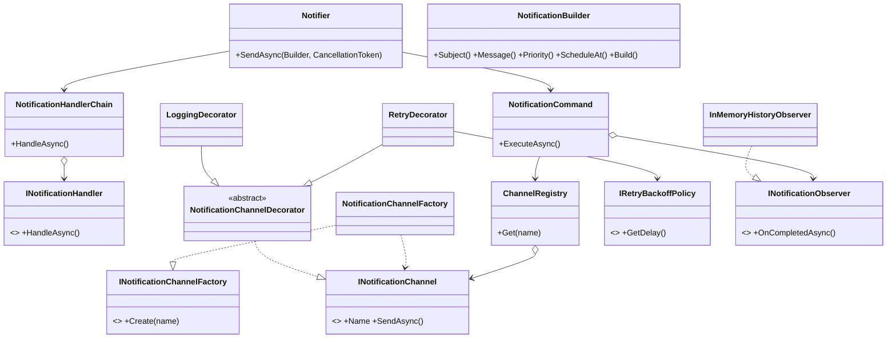
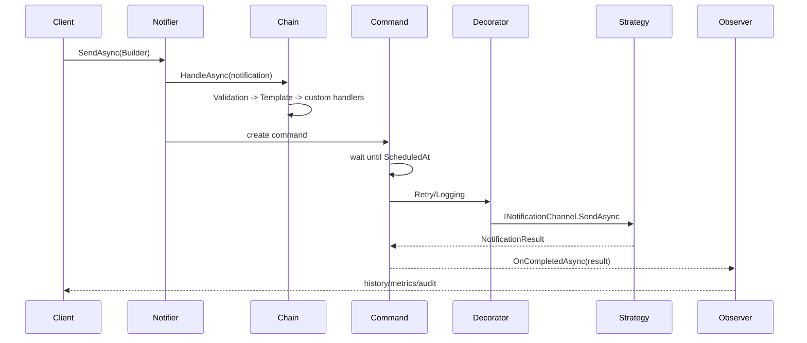

# NotifyKit

Biblioteca C#/.NET 8 para envio de notificações por múltiplos canais, distribuída como
pacote NuGet ou `ProjectReference`. Ela não é uma API nem uma aplicação executável:
o consumidor importa a biblioteca e injeta `Notifier`.

> **Entrega acadêmica:** 
> Alexandre Andrioli Tucci; 
> Livia Rosembach Oliveira;
> Lucas Zanlorenzi Brisch.
> 
> Vídeo: https://youtu.be/1XxT-GpjoQ8.

### O que é o NotifyKit?

O NotifyKit é uma **biblioteca .NET 8**, distribuída como DLL/NuGet, que
oferece uma interface única para enviar notificações por diferentes canais:
e-mail, SMS, push e console. O consumidor não precisa conhecer os detalhes de
cada canal; ele cria uma `Notification`, injeta o `Notifier` e chama
`SendAsync`.

### Qual problema o projeto resolve?

Sem uma biblioteca, a aplicação cliente precisaria ter vários `if`/`switch`
para decidir o canal, regras de retry misturadas ao transporte, validação
acoplada ao envio e código de histórico espalhado. Isso gera alto acoplamento e
torna qualquer mudança arriscada.

O NotifyKit separa essas responsabilidades. A aplicação cliente escolhe o
canal por uma API única; a biblioteca organiza validação, templates, retry,
agendamento, registro do resultado e extensibilidade em componentes pequenos.

## Arquitetura

O núcleo é dividido por responsabilidade:

| Namespace | Responsabilidade | Extensão |
|---|---|---|
| `NotifyKit.Models` / `NotifyKit.Builders` | `Notification`, `NotificationBuilder`, prioridade e resultado | Builder de notificação |
| `NotifyKit.Factories` | criação dos canais padrão | novos canais via DI, sem editar a factory |
| `NotifyKit.Abstractions` | contratos de canais, handlers, observers e backoff | interfaces implementáveis pelo cliente |
| `NotifyKit.Channels` | canais simulados e `ChannelRegistry` | novo canal sem editar a lib |
| `NotifyKit.Handlers` | cadeia de pré-processamento | novo handler |
| `NotifyKit.Decorators` | retry e logging | novos decorators composáveis |
| `NotifyKit.Commands` | comando executável e agendamento | fila/dispatcher futuro |
| `NotifyKit.DependencyInjection` | composição via `AddNotifyKit` | registros adicionais |



## Os seis padrões

### 1. Builder — `NotificationBuilder`

Resolve a construção de um objeto com muitos campos opcionais sem construtor
telescópico ou estado mutável exposto. É adequado porque a chamada fica legível e
o objeto final é imutável: `Notification.Email("user@email.com").Subject("...").Message("...")`.
Uma factory isolada seria curta, mas não expressaria bem combinações opcionais.
O trade-off é uma classe Builder adicional; a conversão implícita mantém a API fluida.

```csharp
await notifier.SendAsync(Notification.Email("user@email.com")
    .Subject("Pedido aprovado")
    .Message("Seu pedido foi enviado!")
    .Priority(NotificationPriority.High));
```

### 2. Strategy — canais e backoff

`INotificationChannel` encapsula algoritmos de transporte intercambiáveis; cada
canal tem o mesmo contrato, sem `Notifier` conhecer SMTP, SMS ou push.
`IRetryBackoffPolicy` aplica o mesmo raciocínio ao cálculo do atraso. Herança ou
`switch` centralizado criariam acoplamento e violariam OCP. O trade-off é mais
interfaces, compensado pela testabilidade e pelos canais plugáveis.

```csharp
public sealed class TelegramChannel : INotificationChannel
{
    public string Name => "telegram";
    public Task<NotificationResult> SendAsync(Notification n, CancellationToken ct = default)
        => Task.FromResult(NotificationResult.Succeeded(n));
}
```

### 3. Decorator — retry, logging e métricas

`RetryDecorator` e `LoggingDecorator` envolvem qualquer `INotificationChannel`
sem modificar o canal. Strategy escolhe **qual algoritmo de envio** executar;
Decorator adiciona **comportamento ao redor da execução**. Portanto não são
redundantes. Middleware ou herança fixa seriam menos composáveis. O trade-off é
uma cadeia que pode ficar difícil de depurar se crescer demais.

```csharp
INotificationChannel channel = new ConsoleChannel();
channel = new LoggingDecorator(channel);
channel = new RetryDecorator(channel, 3,
    new ExponentialBackoffPolicy(TimeSpan.FromMilliseconds(100)));
```

### 4. Chain of Responsibility — pré-envio

`NotificationHandlerChain` passa a notificação por validação, template e futuros
rate limits. Cada handler decide sua responsabilidade e pode interromper com
erro. Um método monolítico ou pipeline acoplado dificultaria reordenar etapas.
O trade-off é a ordem da cadeia ser configuração importante e precisar ser
documentada.

```csharp
public sealed class RateLimitHandler : INotificationHandler
{
    public Task<Notification> HandleAsync(Notification n, CancellationToken ct = default)
        => Task.FromResult(n); // lançar exceção aqui interrompe o envio
}
```

### 5. Command — `NotificationCommand`

Converte a intenção de enviar em um objeto executável, permitindo agendamento,
prioridade e futura fila persistente sem alterar a fachada. Uma chamada direta
não permite enfileirar/reprocessar; uma classe de serviço monolítica mistura
coordenação e execução. O trade-off é criar um objeto por envio, ganho que
viabiliza retry operacional e dispatchers.

```csharp
var command = new NotificationCommand(notification, registry, observers);
var result = await command.ExecuteAsync();
```

### 6. Observer — histórico e resultados

`INotificationObserver` recebe o resultado sem que `NotificationCommand` conheça
armazenamento, métricas ou auditoria. Events seriam uma alternativa idiomática,
mas o contrato assíncrono permite persistência sem bloquear a API. O trade-off é
observers lentos participarem do tempo da operação; em uma versão futura podem
ser publicados em fila.

```csharp
public sealed class AuditObserver : INotificationObserver
{
    public Task OnCompletedAsync(NotificationResult result, CancellationToken ct = default)
    { Console.WriteLine(result.Success); return Task.CompletedTask; }
}
```

## Fluxo



## Uso padrão

```csharp
var services = new ServiceCollection()
    .AddNotifyKit()
    .BuildServiceProvider();
var notifier = services.GetRequiredService<Notifier>();

await notifier.SendAsync(Notification.Console()
    .Message("Executando NotifyKit"));
await notifier.SendAsync(Notification.Email("user@email.com")
    .Subject("Pedido aprovado")
    .Message("Seu pedido foi enviado!")); // transporte simulado
```

`EmailChannel`, `SmsChannel`, `PushChannel`, `ConsoleChannel`,
`InMemoryHistoryObserver` e `ExponentialBackoffPolicy` são implementações
out-of-the-box. Canais reais podem ser adapters sobre SDKs, mantidos fora do
núcleo e registrados por DI.

## Extensão sem alterar a biblioteca

```csharp
public sealed class TelegramChannel : INotificationChannel
{
    public string Name => "telegram";
    public Task<NotificationResult> SendAsync(Notification n, CancellationToken ct = default)
        => Task.FromResult(NotificationResult.Succeeded(n));
}

public sealed class MyObserver : INotificationObserver
{
    public Task OnCompletedAsync(NotificationResult r, CancellationToken ct = default)
    { /* enviar métrica ao sistema do cliente */ return Task.CompletedTask; }
}

var services = new ServiceCollection()
    .AddSingleton<INotificationChannel, TelegramChannel>()
    .AddSingleton<INotificationObserver, MyObserver>()
    .AddNotifyKit()
    .BuildServiceProvider();
await services.GetRequiredService<Notifier>()
    .SendAsync(Notification.For("telegram", "@chloe").Message("Olá!"));
```

### Factory de canais (apoio)

`NotificationChannelFactory` é um apoio arquitetural, não um dos seis padrões
avaliados. Ela centraliza a criação dos quatro canais simulados prontos para uso.
Isso evita `new EmailChannel()` espalhado na composição do DI. Ela não deve ser
alterada para cada extensão: canais do cliente são registrados diretamente:

```csharp
services.AddSingleton<INotificationChannel, TelegramChannel>();
```

Assim, a Factory resolve a criação dos defaults e o `ChannelRegistry` resolve
o canal pelo nome; Strategy continua sendo o padrão responsável pelo algoritmo
de envio.