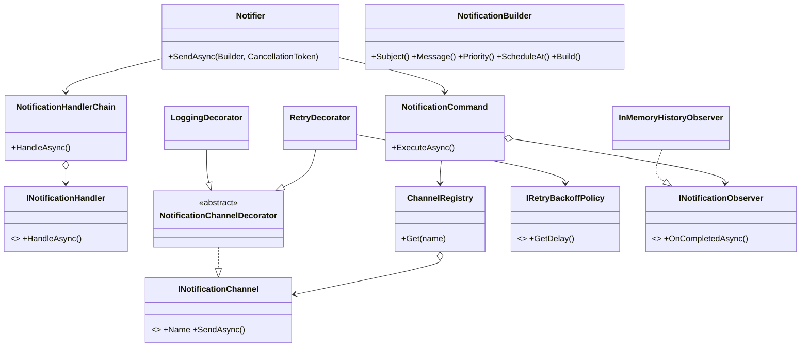
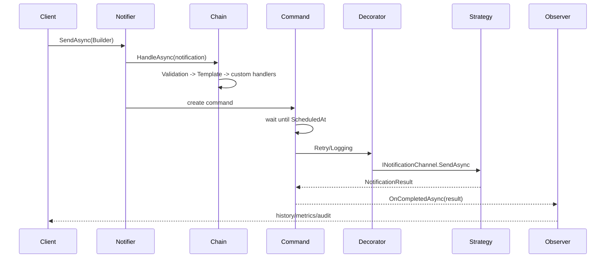

# NotifyKit

Biblioteca C#/.NET 8 para envio de notificações por múltiplos canais, distribuída como
pacote NuGet ou `ProjectReference`. Ela não é uma API nem uma aplicação executável:
o consumidor importa a biblioteca e injeta `Notifier`.

> **Entrega acadêmica:** Aluno 1 — `[nome]`; Aluno 2 — `[nome]`; Aluno 3 — `[nome]`.
> Vídeo: `[link do YouTube]`.

## Arquitetura

O núcleo é dividido por responsabilidade:

| Namespace | Responsabilidade | Extensão |
|---|---|---|
| `NotifyKit.Models` | `Notification`, prioridade e resultado | Builder de notificação |
| `NotifyKit.Abstractions` | contratos de canais, handlers, observers e backoff | interfaces implementáveis pelo cliente |
| `NotifyKit.Channels` | canais simulados e `ChannelRegistry` | novo canal sem editar a lib |
| `NotifyKit.Handlers` | cadeia de pré-processamento | novo handler |
| `NotifyKit.Decorators` | retry e logging | novos decorators composáveis |
| `NotifyKit.Commands` | comando executável e agendamento | fila/dispatcher futuro |
| `NotifyKit.DependencyInjection` | composição via `AddNotifyKit` | registros adicionais |



## Os seis padrões

### 1. Builder — `Notification`

Resolve a construção de um objeto com muitos campos opcionais sem construtor
telescópico ou estado mutável exposto. É adequado porque a chamada fica legível e
o objeto final é imutável: `Notification.Email("user@email.com").Subject("...").Message("...")`.
Uma factory isolada seria curta, mas não expressaria bem combinações opcionais.
O trade-off é uma classe Builder adicional; a conversão implícita mantém a API fluida.

```csharp
await notifier.SendAsync(Notification.Email("user@email.com")
    .Subject("Pedido aprovado")
    .Message("Seu pedido foi enviado!")
    .Priority(NotificationPriority.High));
```

### 2. Strategy — canais e backoff

`INotificationChannel` encapsula algoritmos de transporte intercambiáveis; cada
canal tem o mesmo contrato, sem `Notifier` conhecer SMTP, SMS ou push.
`IRetryBackoffPolicy` aplica o mesmo raciocínio ao cálculo do atraso. Herança ou
`switch` centralizado criariam acoplamento e violariam OCP. O trade-off é mais
interfaces, compensado pela testabilidade e pelos canais plugáveis.

```csharp
public sealed class TelegramChannel : INotificationChannel
{
    public string Name => "telegram";
    public Task<NotificationResult> SendAsync(Notification n, CancellationToken ct = default)
        => Task.FromResult(NotificationResult.Succeeded(n));
}
```

### 3. Decorator — retry, logging e métricas

`RetryDecorator` e `LoggingDecorator` envolvem qualquer `INotificationChannel`
sem modificar o canal. Strategy escolhe **qual algoritmo de envio** executar;
Decorator adiciona **comportamento ao redor da execução**. Portanto não são
redundantes. Middleware ou herança fixa seriam menos composáveis. O trade-off é
uma cadeia que pode ficar difícil de depurar se crescer demais.

```csharp
INotificationChannel channel = new ConsoleChannel();
channel = new LoggingDecorator(channel);
channel = new RetryDecorator(channel, 3,
    new ExponentialBackoffPolicy(TimeSpan.FromMilliseconds(100)));
```

### 4. Chain of Responsibility — pré-envio

`NotificationHandlerChain` passa a notificação por validação, template e futuros
rate limits. Cada handler decide sua responsabilidade e pode interromper com
erro. Um método monolítico ou pipeline acoplado dificultaria reordenar etapas.
O trade-off é a ordem da cadeia ser configuração importante e precisar ser
documentada.

```csharp
public sealed class RateLimitHandler : INotificationHandler
{
    public Task<Notification> HandleAsync(Notification n, CancellationToken ct = default)
        => Task.FromResult(n); // lançar exceção aqui interrompe o envio
}
```

### 5. Command — `NotificationCommand`

Converte a intenção de enviar em um objeto executável, permitindo agendamento,
prioridade e futura fila persistente sem alterar a fachada. Uma chamada direta
não permite enfileirar/reprocessar; uma classe de serviço monolítica mistura
coordenação e execução. O trade-off é criar um objeto por envio, ganho que
viabiliza retry operacional e dispatchers.

```csharp
var command = new NotificationCommand(notification, registry, observers);
var result = await command.ExecuteAsync();
```

### 6. Observer — histórico e resultados

`INotificationObserver` recebe o resultado sem que `NotificationCommand` conheça
armazenamento, métricas ou auditoria. Events seriam uma alternativa idiomática,
mas o contrato assíncrono permite persistência sem bloquear a API. O trade-off é
observers lentos participarem do tempo da operação; em uma versão futura podem
ser publicados em fila.

```csharp
public sealed class AuditObserver : INotificationObserver
{
    public Task OnCompletedAsync(NotificationResult result, CancellationToken ct = default)
    { Console.WriteLine(result.Success); return Task.CompletedTask; }
}
```

## Fluxo



## Uso padrão

```csharp
var services = new ServiceCollection()
    .AddNotifyKit()
    .BuildServiceProvider();
var notifier = services.GetRequiredService<Notifier>();

await notifier.SendAsync(Notification.Console()
    .Message("Executando NotifyKit"));
await notifier.SendAsync(Notification.Email("user@email.com")
    .Subject("Pedido aprovado")
    .Message("Seu pedido foi enviado!")); // transporte simulado
```

`EmailChannel`, `SmsChannel`, `PushChannel`, `ConsoleChannel`,
`InMemoryHistoryObserver` e `ExponentialBackoffPolicy` são implementações
out-of-the-box. Canais reais podem ser adapters sobre SDKs, mantidos fora do
núcleo e registrados por DI.

## Extensão sem alterar a biblioteca

```csharp
public sealed class TelegramChannel : INotificationChannel
{
    public string Name => "telegram";
    public Task<NotificationResult> SendAsync(Notification n, CancellationToken ct = default)
        => Task.FromResult(NotificationResult.Succeeded(n));
}

public sealed class MyObserver : INotificationObserver
{
    public Task OnCompletedAsync(NotificationResult r, CancellationToken ct = default)
    { /* enviar métrica ao sistema do cliente */ return Task.CompletedTask; }
}

var services = new ServiceCollection()
    .AddSingleton<INotificationChannel, TelegramChannel>()
    .AddSingleton<INotificationObserver, MyObserver>()
    .AddNotifyKit()
    .BuildServiceProvider();
await services.GetRequiredService<Notifier>()
    .SendAsync(Notification.For("telegram", "@chloe").Message("Olá!"));
```

## Estrutura Maven equivalente / estrutura da solution

O projeto entregue é `.NET`:

```text
pulse-notify.sln
└── pulse-notify/
    ├── pulse-notify.csproj        # net8.0, class library, NotifyKit.dll
    └── src/
        ├── Models/
        ├── Abstractions/
        ├── Channels/
        ├── Strategies/
        ├── Decorators/
        ├── Handlers/
        ├── Commands/
        ├── Observers/
        └── DependencyInjection/
```

API pública principal: `Notifier`, `Notification`, `NotificationResult`,
`INotificationChannel`, `INotificationHandler`, `INotificationObserver`,
`IRetryBackoffPolicy`, `ChannelRegistry` e `AddNotifyKit`.

## Plano de trabalho

**Parcial — 04/11, 30% (implementar nesta noite):** concluir os modelos,
Builder, `INotificationChannel`, quatro canais simulados, `ChannelRegistry`,
`Notifier`, `ValidationHandler`, `NotificationCommand`, observer em memória e
`AddNotifyKit`. Mostrar no vídeo: um envio Console e um Email, o diagrama de
classes e a defesa Builder + Strategy/Command. O retry pode ser demonstrado
isoladamente com `RetryDecorator` e backoff de atraso mínimo.

**05/11:** adicionar testes xUnit para Builder, validação, registry e resultado.
**06/11:** completar composição de Decorators e testes de retry/backoff.
**07/11:** completar templates, handler de rate limit e testes da Chain.
**08/11:** revisar agendamento/prioridade e separar dispatcher/fila se necessário.
**09/11:** criar Demo console fora do artefato e exemplos de extensão Telegram.
**10/11:** revisão de API pública, nullable, documentação XML e pacote NuGet local.
**11/11:** gravar e editar o vídeo; ensaiar os três roteiros e validar clone limpo.
**12/11:** publicar README, vídeo, pacote e entrega final.

## Roteiro do vídeo (2–3 minutos por aluno)

**Aluno 1 — Builder + Strategy:** apresentar o problema do construtor telescópico
e mostrar `Notification.Builder`; depois explicar que `INotificationChannel`
representa algoritmos de transporte e que `IRetryBackoffPolicy` troca a política
sem alterar o retry. Enfatizar OCP e a diferença entre escolher algoritmo e
adicionar comportamento.

**Aluno 2 — Decorator + Chain:** mostrar a composição `LoggingDecorator` +
`RetryDecorator`, explicar que o componente interno mantém o mesmo contrato e
que decorators são opcionais. Em seguida mostrar `ValidationHandler` e
`TemplateHandler` em sequência, defendendo coesão, ordem explícita e interrupção
por erro.

**Aluno 3 — Command + Observer:** mostrar como `NotificationCommand` encapsula
agendamento e execução e pode ser colocado numa fila no futuro. Depois explicar
que observers recebem resultado sem acoplamento a histórico, auditoria ou
métricas; finalizar com `InMemoryHistoryObserver` e um observer criado pelo
cliente.
